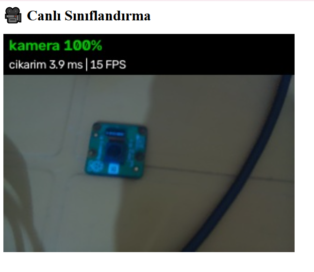
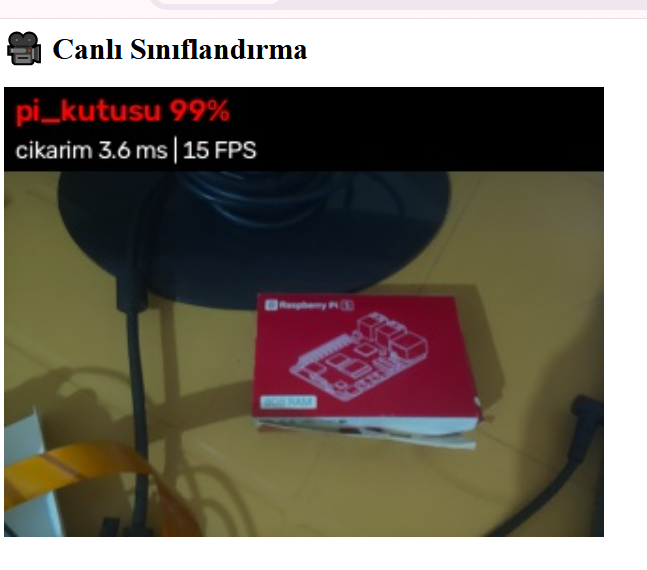
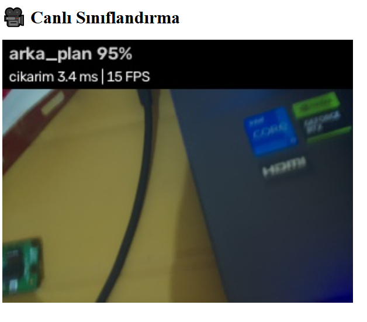

# 🍓 Raspberry Pi 5 — Kendi Görüntü Sınıflandırıcım (Edge Impulse + LiteRT)

**Kendi veri setimi Pi kamerasıyla topladım, Edge Impulse'da MobileNet V2 ile transfer learning yaptım ve int8 quantized modeli Raspberry Pi 5'te 1.9 ms'de canlı çalıştırdım.**
Edge AI serisinin 3. bölümü — 🏆 **Proje 1**.

-C51A4A?logo=raspberrypi&logoColor=white)


<p align="center">
  
  
  
</p>

---

## 🎯 Problem

Bölüm 2'de ImageNet'te eğitilmiş MobileNet V2'ye Raspberry Pi'yi gösterdiğimde **"modem"** dedi — çünkü ImageNet'in 1000 sınıfında "Raspberry Pi" yok (*closed-set* problemi).

**Hedef:** ImageNet'te olmayan nesneleri tanıyan, Raspberry Pi 5 üzerinde **gerçek zamanlı** çalışan kendi sınıflandırıcımı yapmak.

| Sınıf | Açıklama |
|---|---|
| 📷 `kamera` | Raspberry Pi Camera Module v2 |
| 🍓 `pi_kutusu` | Raspberry Pi'nin kırmızı-beyaz kutusu |
| ⬜ `arka_plan` | Nesneler yokken aynı çalışma alanı |

---

## 🏗️ Sistem mimarisi

```
┌──────────── Raspberry Pi 5 ────────────┐      ┌──────── Edge Impulse (bulut) ────────┐
│                                        │      │                                      │
│ 📷 IMX219 ──ISP──▶ 320×240 RGB          │      │  Upload (80/20 train/test split)     │
│        │                               │      │        │                             │
│        ▼                               │ 180  │        ▼                             │
│ get_img_data.py (Flask, Space=çek) ────┼─────▶│  Image block: 160×160 squash, RGB    │
│   dataset/{kamera,pi_kutusu,arka_plan} │ foto │        │                             │
│                                        │      │        ▼                             │
│                                        │      │  Transfer learning: MobileNetV2      │
│ models/model_int8.tflite ◀─────────────┼──────│  160×160 α=1.0 (+ augmentation)      │
│        │                               │ .tflite       │                             │
│        ▼                               │      │        ▼                             │
│ live_classify.py (Flask, canlı akış)   │      │  int8 quantization                   │
│   → "pi_kutusu 99%" | 1.9 ms           │      │                                      │
└────────────────────────────────────────┘      └──────────────────────────────────────┘
```

---

## 📊 Sonuçlar

### Eğitim ve test (Edge Impulse)
| Metrik | Validation | Test (35 görüntü, hiç görülmemiş) |
|---|---|---|
| Doğruluk | **%100** | **%100** |
| F1 (her sınıf) | 1.00 | 1.00 |
| Belirsiz (uncertain) | — | %0 |

### Raspberry Pi 5 üzerinde float32 vs int8 (4 thread, 180 görüntü)
| Model | Boyut | Çıkarım süresi | Doğruluk | int8 ile uyum |
|---|---|---|---|---|
| float32 | 9.2 MB | 5.24 ± 0.68 ms | %100 | — |
| **int8** | **2.8 MB** | **1.89 ± 0.16 ms** (~530 FPS) | **%100** | **%100** |

➡️ int8: **2.8x daha hızlı**, **3.3x daha küçük**, **sıfır doğruluk kaybı**.

### 🎥 Canlı uygulama (kamera + çıkarım + JPEG + web akışı aynı anda)
| Sahne | Tahmin | Çıkarım | Sistem FPS |
|---|---|---|---|
| Pi kutusu | `pi_kutusu` **%99** | 3.6 ms | 15 |
| Kamera modülü | `kamera` **%100** | 3.9 ms | 15 |
| Boş çalışma alanı (köşede bir devre kartı görünürken bile) | `arka_plan` **%95** | 3.4 ms | 15 |

➡️ Model tek başına ~270 FPS'e yetecek hızda; sistem 15 FPS'te. **Darboğaz model değil**, kamera yakalama + renk dönüşümü + JPEG encode + web akışı zinciri. Canlıda çıkarımın 1.9 ms yerine ~3.5 ms sürmesi de çekirdeklerin bu işlerle paylaşılmasından.

> ⚠️ **Dürüstlük notu:** Veri tek oturumda, tek ortamda toplandı; Edge Impulse'daki feature explorer'da sınıflar çok ayrık ve sıkı kümeler oluşturuyor. %100 doğruluk bu **kolay** problem için beklenen bir sonuç; farklı ışık/ortamda genelleme için daha çeşitli veri gerekir (bkz. [Öğrenilen dersler](#-öğrenilen-dersler)).

---

## 📁 Repo yapısı

```
├── get_img_data.py        # Flask tabanlı veri toplama aracı (canlı önizleme, Space ile çekim)
├── inspect_models.py      # .tflite modellerinin giriş/çıkış tipi ve quantization parametreleri
├── compare_models.py      # float32 vs int8: boyut, hız, doğruluk, uyum
├── live_classify.py       # Canlı sınıflandırma web uygulaması (güven eşiği + FPS)
├── models/
│   ├── model_int8.tflite      # 2.8 MB — Pi'de kullanılan model
│   └── model_float32.tflite   # 9.2 MB — karşılaştırma için
├── dataset.zip            # 180 görüntü (3 sınıf × 60), 320×240 JPEG
├── assets/                # README görselleri
└── 03-custom-classification.md   # Adım adım ders notu (teori + uygulama + mülakat notları)
```

---

## ⚡ Hızlı başlangıç

```bash
# Ortam (Bölüm 2'deki venv)
source ~/tflite_env/bin/activate
pip install flask ai-edge-litert opencv-python

git clone https://github.com/ebrarklc/raspberry-pi5-custom-image-classifier.git
cd raspberry-pi5-custom-image-classifier

# 1) Kendi veri setini topla  →  http://<PI_IP>:5000
python get_img_data.py

# 2) Modelleri incele / karşılaştır
python inspect_models.py
unzip dataset.zip && python compare_models.py

# 3) Canlı sınıflandırma  →  http://<PI_IP>:5000
python live_classify.py
```

---

## 🔑 Teknik detaylar

### Modelin giriş/çıkışı (int8)
```
GİRİŞ : [1 160 160 3] int8 | scale = 1/255, zero_point = −128   →  q = piksel − 128
ÇIKIŞ : [1 3]         int8 | scale = 1/256, zero_point = −128   →  olasılık = (q + 128) / 256
```

| | Bölüm 2: MobileNet (ImageNet) | Bu proje: Edge Impulse modeli |
|---|---|---|
| Giriş | 224×224, **uint8**, normalizasyon [−1, 1] | 160×160, **int8**, normalizasyon [0, 1] |
| Çıkış | 1001 **logit** → softmax gerekir | 3 **olasılık** → softmax **gerekmez** (modelin içinde) |

### Ön işleme (eğitimle birebir aynı)
```python
x = cv2.resize(frame, (160, 160), interpolation=cv2.INTER_AREA)   # squash: Edge Impulse ile aynı
x = (x.astype(np.int16) - 128).astype(np.int8)[None]              # int16 ara adımı: uint8 taşmasını önler
```

### Training/serving skew'e karşı alınan önlemler
- Veri toplama ve canlı çıkarımda **birebir aynı** kamera ayarları: `main=(320, 240)`, `sensor=(1640, 1232)` (tam görüş alanı), `BGR888`
- Aynı resize yöntemi (**squash**)
- `arka_plan` sınıfı, nesnelerin bulunduğu **aynı ortamdan** toplandı

### Eğitim ayarları
| Parametre | Değer |
|---|---|
| Model | MobileNetV2 160×160, α = 1.0 (ImageNet ağırlıkları) |
| Epoch | 20 (+ Edge Impulse fine-tuning aşaması) |
| Learning rate | 0.0005 |
| Validation | %20 |
| Data augmentation | ✅ (flip, crop/zoom, parlaklık) |
| Head | 0 gizli nöron, dropout 0.1, 3 çıkış |

---

## 🧠 Öğrenilen dersler

| Durum | Ders |
|---|---|
| Bir sınıfın fotoğrafları yanlış etiketle çekildi | **Yanlış etiket = sessiz hata.** Klasör = etiket olduğunda veri setini en baştan temiz kurmak en güvenlisi. |
| `arka_plan` önce farklı bir yerde (sandalye) çekildi | **Shortcut learning:** Model nesneye değil zemine bakmayı öğrenirdi. Negatif sınıf **hedef ortamdan** toplanmalı. |
| Edge Impulse'a toplu yüklemede etiketler boş kaldı | Etiket bilgisi olmadan **gözetimli öğrenme** olmaz. Sınıf sınıf, etiket açıkça girilerek yüklendi. |
| Etikette yazım hatası (`arka_paln`) | Etiketler modele gömülür; **erken yakalanan hata ucuzdur.** |
| Dokümandaki çekim kodu saniye hassasiyetinde dosya adı veriyor | Aynı saniyedeki iki çekim birbirinin üzerine yazar. **Milisaniyeli** isim kullanıldı. |
| `mv dataset/kamera dataset/pi_kutusu` | Hedef klasör varsa yeniden adlandırmaz, **içine taşır**. Önce kontrol et! |
| `uint8 − 128` | Taşma! Önce `int16`'ya çevir. |
| Kamera "Device or resource busy" | Kamera aynı anda tek sürece hizmet eder (`pgrep -af python`). |

---

## 🚀 Geliştirme fikirleri
- [ ] Farklı gün/ışık/ortamda toplanmış **bağımsız bir test seti** ile gerçek genelleme ölçümü
- [ ] Daha küçük modeller (MobileNetV2 96×96 α=0.35) ile hız–doğruluk ödünleşimi
- [ ] Ardışık karelerde **oylama/yumuşatma** ile titreşimsiz tahmin
- [ ] Bilinmeyen nesneler için daha akıllı "belirsiz" tespiti (OOD)

---

## 🗺️ Edge AI serisi

| # | Bölüm | Repo |
|---|---|---|
| 1 | Raspberry Pi 5 kurulumu | [raspberry-pi5-edge-ai-setup](https://github.com/ebrarklc/raspberry-pi5-edge-ai-setup) |
| 2 | Görüntü sınıflandırma temelleri | [raspberry-pi5-image-classification-litert](https://github.com/ebrarklc/raspberry-pi5-image-classification-litert) |
| 3 | 🏆 Kendi görüntü sınıflandırıcım | 📍 *bu repo* |
| 4 | 🏆 Nesne tespiti | 🔜 |

---

## 📚 Kaynaklar
- Marcelo Rovai — *Edge AI Engineering: Hands-On with the Raspberry Pi* (UNIFEI, 2026), s. 110–144
- [Edge Impulse — Transfer learning (images)](https://docs.edgeimpulse.com/)
- Sandler et al. (2018) — *MobileNetV2: Inverted Residuals and Linear Bottlenecks*

## 👤 Hazırlayan
**Ebrar Kılıç** — Edge AI & Embedded Systems · [github.com/ebrarklc](https://github.com/ebrarklc)
